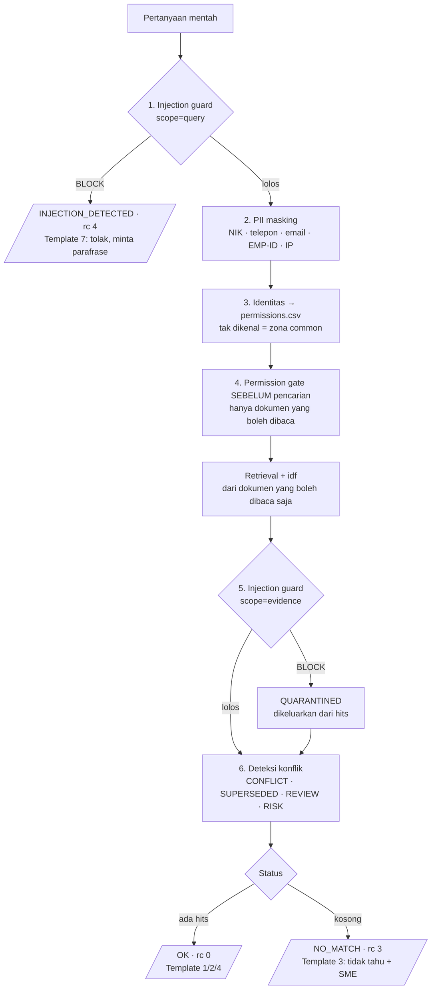
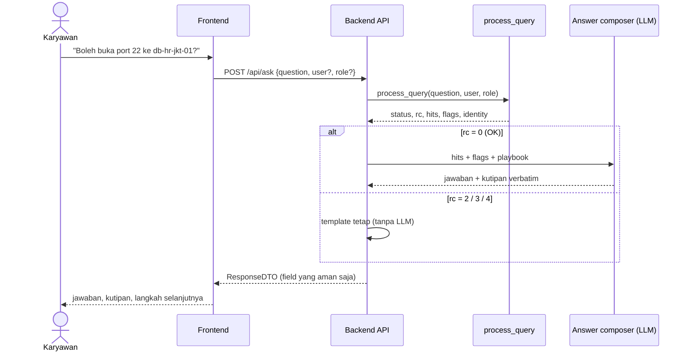
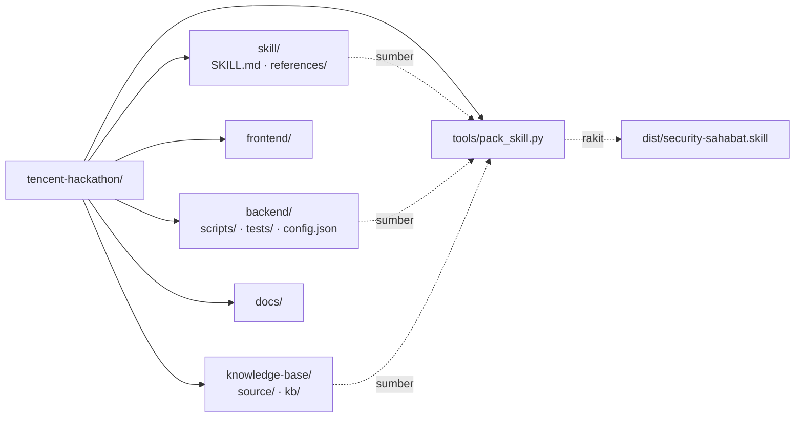

# SecuritySahabat — System Design

Acuan bersama tim. Diagram di bawah memakai Mermaid (ter-render otomatis di GitHub).

Diagram arsitektur untuk submission (komponen, batas kepercayaan, trade-off,
termasuk Pra-CAB): [architecture-diagram.svg](architecture-diagram.svg).

Legenda status: **✅ sudah ada** · **🟡 direncanakan** (belum ada kodenya).

## 1. Gambaran sistem


Dua jalur pemakaian, satu inti yang sama (`process_query`):

| Jalur | Siapa yang menulis jawaban akhir | Status |
| --- | --- | --- |
| **Claude Skill** (`dist/security-sahabat.skill`) | Claude, mengikuti `skill/references/answer-playbook.md` | ✅ jalan |
| **Web app** (frontend → API) | Answer composer di backend (LLM + playbook yang sama) | 🟡 dibangun |

## 2. Pipeline `process_query()` (✅)

Urutan **tidak boleh ditukar** — setiap tahap menjaga tahap berikutnya.



## 3. Alur request web app (🟡 target)



## 4. Kontrak API — draf untuk disepakati FE ↔ BE

`POST /api/ask`

```json
{ "question": "Saya Andini, IT Admin. Boleh buka port 22 ke db-hr-jkt-01?",
  "user": null, "role": null }
```

Response (hanya field ini yang boleh keluar ke browser; diterapkan di
`backend/api/server.py`, diuji `backend/tests/test_api.py`):

```json
{
  "q_id": "Q-0091a2d7fa37",
  "status": "OK",
  "rc": 0,
  "answer": null,
  "citations": [
    { "doc_id": "CTRL-09", "title": "A.8.20 Networks security",
      "section": "A.8.20 Networks security", "quote": "SSH (port 22) from the internet ...",
      "owner": "Citra Kusuma (SOC Analyst)", "effective_date": "2026-08-01",
      "status": "active", "risk_level": "critical" }
  ],
  "flags": [ { "type": "REVIEW", "doc": "SOP-9", "detail": "..." } ],
  "escalation": "Citra Kusuma (SOC Analyst)",
  "question_masked": "Boleh buka port 22 ke db-hr-jkt-01?",
  "identity": { "user": "Andini Pratama", "role": "IT Admin" },
  "pii_masked": "NIK x1"
}
```

- `q_id`: nomor catatan audit log; sama dengan baris di `backend/logs/audit.jsonl`.
- `answer`: untuk `OK` bernilai `null` kecuali `backend/scripts/ask_bridge.py`
  (28 Okt, tanpa LLM) punya isi: klarifikasi (nama yang dimiliki >1 staf, jadwal
  tanpa zona waktu, aset yang tidak jelas), pemberitahuan bahwa perintah aksi
  tidak dijalankan, atau verdict dari policy register untuk aset + jenis
  perubahan yang disebut ("tidak boleh" hanya bila ada aturan `BLOCK`, dengan id
  aturannya). Untuk `NO_MATCH` kalimat tetap, didahului isi jembatan bila ada;
  untuk `INJECTION_DETECTED` kalimat tetap.
- `flags[].type` dari jembatan: `CLARIFY`, `ACTION_REQUEST`, `POLICY_BLOCK`,
  `POLICY_PREVIEW`. Kutipan aturan (mis. TOPO-PRAYER-TIMES, CHAT memo) ikut
  ditambahkan ke `citations`. Audit log mencatat `approval_state`
  (`n/a` · `pending` · `blocked`) dan ringkasan `bridge`.
- `question_masked`: pertanyaan setelah penyamaran PII; `null` untuk injection.
  Frontend menampilkan ini, bukan teks yang diketik.
- `identity`: `null`/`null` bila penanya tidak dikenali.
- Galat: `{"error": {"code", "message"}}` dengan HTTP 400 (validasi, maks 2000
  karakter), 413 (body > 16 KB), 415 (bukan JSON), 404, 405, 500. Pesan galat
  tidak pernah menggemakan masukan.

| `status` | `rc` | Yang ditampilkan frontend |
| --- | --- | --- |
| `OK` | 0 | jawaban + daftar kutipan + flag (badge) |
| `NO_MATCH` | 3 | "Tidak tahu" (Template 3) + nama SME |
| `INJECTION_DETECTED` | 4 | permintaan parafrase |

**Existence leak (non-interference):** dokumen yang tidak boleh dibaca
penanya (proyek restricted di luar `allowed_projects`, zona di luar
`allowed_zones`) dilewati sebelum penilaian dan tidak ikut menghitung idf.
Bagi penanya itu, keluaran apa pun sama persis dengan keluaran saat dokumen
tersebut tidak ada; tidak ada status khusus untuk topik restricted. Diuji
dengan menjalankan pertanyaan yang sama terhadap KB lengkap dan KB yang
dipangkas (`NonInterferenceTest`). Keputusan: [decisions/0002](decisions/0002-existence-leak-differential.md).

**Identitas di API** hanya dari field `user` yang persis cocok dengan nama di
`permissions.csv`; klaim di teks pertanyaan dan field `role` tidak dipakai.
Belum ada autentikasi: pemilih persona di UI berperan sebagai login demo.

**Wajib disaring di API (jangan pernah dikirim ke frontend):**

- `kb_root` — path server.
- `permission_gate` (termasuk `readable_ids` dan `dropped` untuk `risk_gate: enforce`).
- `quarantined` (isi), `mask_log`, `injection_check`.
- `permissions.allowed_projects` — bisa membocorkan nama proyek restricted.

## 5. Struktur repo & kepemilikan



| Folder | Isi | Owner |
| --- | --- | --- |
| `knowledge-base/` | Dokumen compliance + `permissions.csv` | Tim (perubahan via PR) |
| `backend/` | Retrieval, guard, permission gate, API | Izzat |
| `frontend/` | Chat UI | Rekan FE |
| `skill/` | Instruksi Claude Skill | Izzat |
| `docs/` | Desain sistem (file ini), `specs/` per fase, memory WorkBuddy | Semua |
| `adjusted_brief.md` | Brief proyek: rumusan masalah, S1–S6, 20 test case | Izzat |

## 6. Keputusan desain yang mengikat

1. **Tanpa kutipan = tanpa klaim.** Jawaban tanpa bukti di KB adalah "tidak tahu".
2. **Restricted = tidak ada.** Tidak dikonfirmasi maupun disangkal, termasuk di UI, log, dan pesan error.
3. **Kutipan verbatim** — PII hanya disamarkan di pertanyaan, tidak di kutipan.
4. **Ragu → tidak boleh**, lalu eskalasi ke owner dokumen.
5. Regresi `backend/tests/verify_matrix.py` (46 kasus) wajib lulus sebelum merge.
