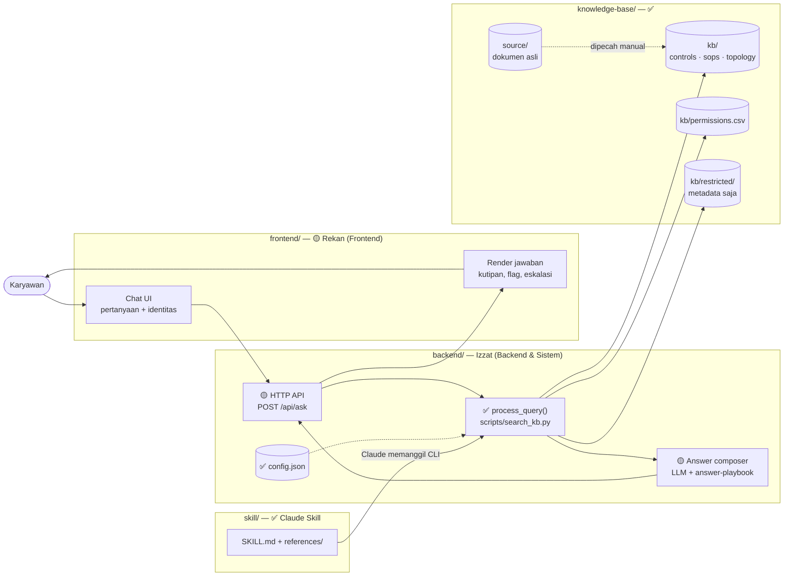
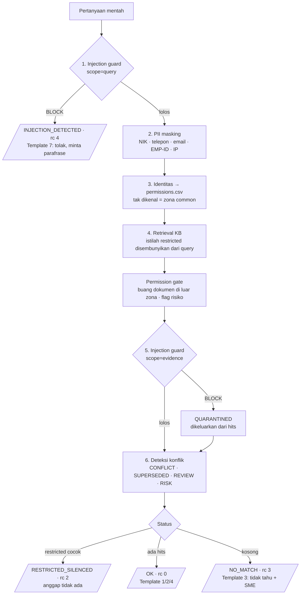
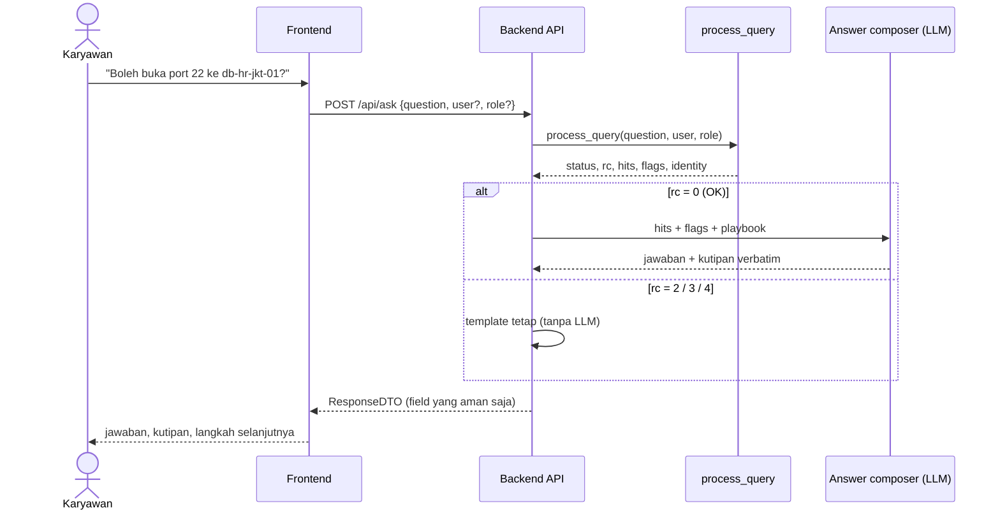
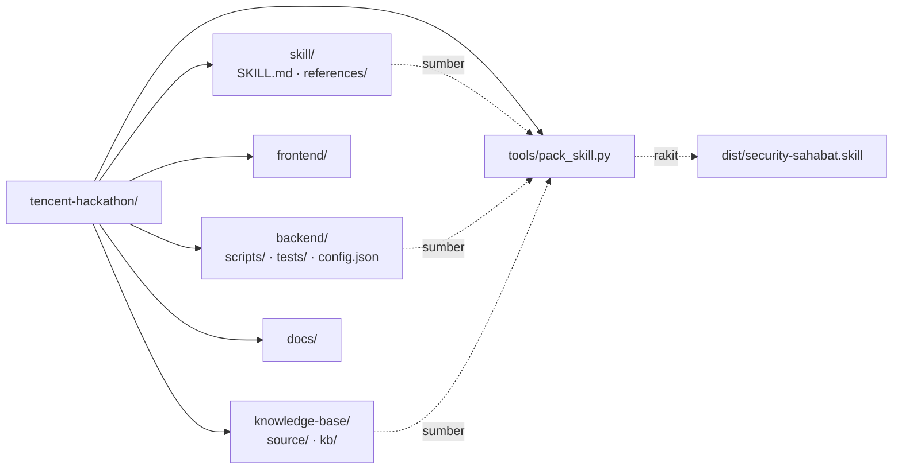

# SecuritySahabat — System Design

Acuan bersama tim. Diagram di bawah memakai Mermaid (ter-render otomatis di GitHub).

Legenda status: **✅ sudah ada** · **🟡 direncanakan** (belum ada kodenya).

## 1. Gambaran sistem



Dua jalur pemakaian, satu inti yang sama (`process_query`):

| Jalur | Siapa yang menulis jawaban akhir | Status |
| --- | --- | --- |
| **Claude Skill** (`dist/security-sahabat.skill`) | Claude, mengikuti `skill/references/answer-playbook.md` | ✅ jalan |
| **Web app** (frontend → API) | Answer composer di backend (LLM + playbook yang sama) | 🟡 dibangun |

## 2. Pipeline `process_query()` (✅)

Urutan **tidak boleh ditukar** — setiap tahap menjaga tahap berikutnya.



## 3. Alur request web app (🟡 target)



## 4. Kontrak API — draf untuk disepakati FE ↔ BE

`POST /api/ask`

```json
{ "question": "Saya Andini, IT Admin. Boleh buka port 22 ke db-hr-jkt-01?",
  "user": null, "role": null }
```

Response (hanya field ini yang boleh keluar ke browser):

```json
{
  "status": "OK",
  "rc": 0,
  "answer": "Tidak boleh. ...",
  "citations": [
    { "doc_id": "CTRL-09", "title": "A.8.20 Networks security",
      "section": "SSH exposure", "quote": "SSH (port 22) from the internet ...",
      "owner": "Citra Kusuma (SOC Analyst)" }
  ],
  "flags": [ { "type": "CONFLICT", "detail": "..." } ],
  "identity": { "user": "Andini Pratama", "role": "IT Admin" },
  "pii_masked": "NIK x1",
  "escalation": "Andini Pratama (IT Admin)"
}
```

| `status` | `rc` | Yang ditampilkan frontend |
| --- | --- | --- |
| `OK` | 0 | jawaban + daftar kutipan + flag (badge) |
| `NO_MATCH` | 3 | "Tidak tahu" (Template 3) + nama SME |
| `INJECTION_DETECTED` | 4 | permintaan parafrase |

**Existence leak:** API wajib mengirim `RESTRICTED_SILENCED` (rc 2) ke frontend
sebagai `NO_MATCH` dengan payload yang identik — status `RESTRICTED_SILENCED`
tidak boleh pernah sampai ke browser, karena status yang berbeda saja sudah
membedakan "dirahasiakan" dari "tidak ada". Proyek restricted terbuka hanya
bagi user yang `allowed_projects`-nya memuat `project` dokumen itu.

| Status internal | Status ke frontend |
| --- | --- |
| `OK` | `OK` |
| `RESTRICTED_SILENCED` | `NO_MATCH` |
| `NO_MATCH` | `NO_MATCH` |
| `INJECTION_DETECTED` | `INJECTION_DETECTED` |

**Wajib disaring di API (jangan pernah dikirim ke frontend):**

- `kb_root` — path server.
- `permission_gate.dropped` — berisi `doc_id` dokumen di luar akses penanya.
- `quarantined` (isi), `restricted_matches`, `mask_log`, `injection_check`.
- `permissions.allowed_projects` — bisa membocorkan nama proyek restricted.

## 5. Struktur repo & kepemilikan



| Folder | Isi | Owner |
| --- | --- | --- |
| `knowledge-base/` | Dokumen compliance + `permissions.csv` | Tim (perubahan via PR) |
| `backend/` | Retrieval, guard, permission gate, API | Izzat |
| `frontend/` | Chat UI | Rekan FE |
| `skill/` | Instruksi Claude Skill | Izzat |
| `docs/` | Desain sistem (file ini), `specs/` per fase, memory WorkBuddy | Semua |
| `adjusted_brief.md` | Brief proyek: rumusan masalah, S1–S6, 20 test case | Izzat |

## 6. Keputusan desain yang mengikat

1. **Tanpa kutipan = tanpa klaim.** Jawaban tanpa bukti di KB adalah "tidak tahu".
2. **Restricted = tidak ada.** Tidak dikonfirmasi maupun disangkal, termasuk di UI, log, dan pesan error.
3. **Kutipan verbatim** — PII hanya disamarkan di pertanyaan, tidak di kutipan.
4. **Ragu → tidak boleh**, lalu eskalasi ke owner dokumen.
5. Regresi `backend/tests/verify_matrix.py` (44 kasus) wajib lulus sebelum merge.
